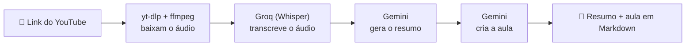
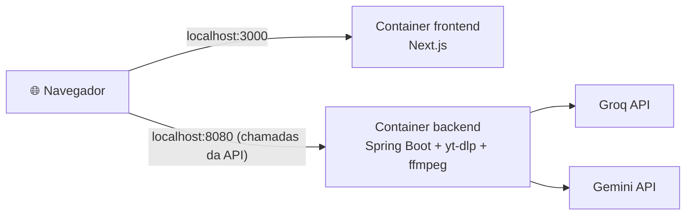

<div align="center">

# 🎓 ViraAula

**Do YouTube para o seu aprendizado: resumos e aulas completas, geradas por IA.**


</div>

<!--
  DICA: adicione uma captura de tela do app em docs/screenshot.png e descomente a linha abaixo.
  <p align="center"></p>
-->

O ViraAula recebe o link de um vídeo do YouTube e usa inteligência artificial para gerar um **resumo** e uma **aula completa** em Markdown, prontos para copiar e colar no Notion, no Google Docs ou no bloco de notas. Funciona melhor com vídeos em que o conteúdo está no áudio: aulas, podcasts, palestras e relatos.

## 📑 Sumário

- [Como funciona](#-como-funciona)
- [Tecnologias](#-tecnologias)
- [Chaves de API](#-chaves-de-api-gratuitas)
- [Rodando com Docker (recomendado)](#-rodando-com-docker-recomendado)
- [Decisões técnicas do Docker](#-decisões-técnicas-do-docker)
- [Rodando sem Docker](#-rodando-sem-docker-modo-desenvolvimento)
- [Como usar](#-como-usar)
- [API do back-end](#-api-do-back-end)
- [Limitações conhecidas](#-limitações-conhecidas)
- [Autor](#-autor)

## ⚙️ Como funciona



O áudio é processado durante a requisição e **não fica salvo** na máquina de quem usa. O projeto não usa banco de dados.

## 🧰 Tecnologias

| Camada | Tecnologias |
|---|---|
| **Back-end** (`viraaula-backend`) | Java 21, Spring Boot 4, Maven |
| **Front-end** (`viraaula-frontend`) | Next.js 16, React 19, TypeScript, Tailwind CSS 4 |
| **IA** | Groq (Whisper) para transcrição e Google Gemini para texto, ambos com plano gratuito |
| **Áudio** | yt-dlp e ffmpeg |
| **Infraestrutura** | Docker e Docker Compose |

## 🔑 Chaves de API (gratuitas)

1. **Groq:** crie uma chave em [console.groq.com](https://console.groq.com)
2. **Gemini:** crie uma chave em [aistudio.google.com](https://aistudio.google.com)

> ⚠️ Nunca coloque suas chaves em arquivos que vão para o Git. Este projeto lê as chaves de **variáveis de ambiente** (ou do arquivo `.env`, que está no `.gitignore`).

## 🐳 Rodando com Docker (recomendado)

É a forma mais simples: você **não precisa instalar** Java, Node, Maven, yt-dlp nem ffmpeg. Tudo isso já vem dentro das imagens Docker.

**Pré-requisito:** [Docker Desktop](https://www.docker.com/products/docker-desktop/) instalado e **aberto** (Mac, Windows ou Linux).

```bash
# 1. Clonar o projeto
git clone https://github.com/umycael/viraaula.git
cd viraaula

# 2. Criar o arquivo de configuração com as suas chaves
cp .env.example .env          # no PowerShell: Copy-Item .env.example .env
# abra o arquivo .env e substitua pelos valores reais das suas chaves

# 3. Subir tudo
docker compose up --build
```

Depois que terminar de subir, abra [http://localhost:3000](http://localhost:3000).

### Comandos do dia a dia

| Comando | O que faz |
|---|---|
| `docker compose up --build` | Constrói as imagens e sobe os dois containers |
| `docker compose up -d` | Sobe em segundo plano |
| `docker compose logs -f` | Acompanha os logs (`Ctrl + C` para sair) |
| `docker compose ps` | Lista os containers em execução |
| `docker compose down` | Para e remove os containers |

### Arquitetura



São **dois containers**, um por serviço. O `docker-compose.yml` descreve os dois e sobe tudo com um comando. As chamadas à API partem do **navegador** (no seu computador) direto para a porta publicada do back-end.

### Problemas comuns

| Sintoma | Causa provável | O que fazer |
|---|---|---|
| `failed to connect to the docker API` ou `Cannot connect to the Docker daemon` | Docker Desktop fechado | Abra o Docker Desktop e espere o motor iniciar |
| `port is already allocated` | Porta 3000 ou 8080 ocupada | Pare o outro processo (ou containers antigos com `docker compose down`) |
| Erro ao baixar o vídeo (`yt-dlp`) | O YouTube mudou e a versão fixada ficou antiga | Veja [Atualizando o yt-dlp](#atualizando-o-yt-dlp) |
| Build do back-end falha em `application.properties` | Arquivo salvo fora de UTF-8 | Salve o arquivo em UTF-8 |

## 🧠 Decisões técnicas do Docker

Esta seção explica **por que** o Docker foi configurado desta forma.

### Um Dockerfile por serviço

Cada parte do projeto tem sua própria imagem: `viraaula-backend/Dockerfile` e `viraaula-frontend/Dockerfile`. O `docker-compose.yml`, na raiz, junta os dois.

### Dependências do sistema dentro da imagem

O back-end chama o **yt-dlp** e o **ffmpeg** como programas do sistema. Em um computador de desenvolvimento eles costumam estar instalados, mas um container começa como um Linux vazio. Por isso a imagem do back-end instala os dois no próprio Dockerfile. Foi exatamente esse o erro encontrado no primeiro teste em container (`Erro ao executar o yt-dlp. Ele está instalado?`), e é o tipo de diferença entre máquinas que o Docker elimina.

### Build em duas etapas (multi-stage) no back-end

A primeira etapa usa uma imagem com Maven e Java 21 para compilar o projeto e gerar o `.jar`. A segunda parte de uma imagem só com o Java para **executar**, e copia apenas o `.jar` pronto. Assim a imagem final não carrega Maven nem código-fonte, e fica menor.

### Segredos fora das imagens

As chaves de API **não estão escritas** em nenhum Dockerfile nem no `docker-compose.yml`. O Compose lê o arquivo `.env` (ignorado pelo Git) e entrega os valores ao container **somente na hora de executar**, como variáveis de ambiente. O repositório traz apenas o `.env.example`, com valores de exemplo.

### A URL da API é gravada no build do front-end

Variáveis `NEXT_PUBLIC_*` do Next.js são embutidas no JavaScript durante o `npm run build`, não lidas ao executar. Por isso o Dockerfile do front-end recebe `NEXT_PUBLIC_API_URL` como `ARG` (padrão `http://localhost:8080`), e o Compose repassa esse valor no build. Se a URL do back-end mudar, é preciso reconstruir a imagem do front-end.

### Cache de dependências no front-end

No Dockerfile do front-end, o `package.json` é copiado e as dependências são instaladas **antes** de copiar o restante do código. Assim, ao editar um componente, o Docker reaproveita a etapa de `npm ci` e o rebuild fica rápido.

### Versão do yt-dlp fixada

O yt-dlp é baixado em uma **versão específica**, definida em um único lugar: o `ARG YTDLP_VERSION` no início da segunda etapa de `viraaula-backend/Dockerfile`.

**Por que não usar sempre a mais recente?** Porque o resultado de um build passaria a depender do dia em que ele foi feito. Duas pessoas construindo o projeto em datas diferentes teriam versões diferentes, e uma atualização inesperada poderia quebrar algo sem nenhuma mudança no código. Com a versão fixada, o ambiente é o mesmo para qualquer pessoa, e as mudanças passam a ser **intencionais e testadas**.

**A contrapartida:** o YouTube muda com frequência, e uma versão antiga do yt-dlp pode parar de funcionar com o tempo. Por isso existe o procedimento abaixo.

#### Atualizando o yt-dlp

Se o app começar a falhar ao baixar vídeos:

1. Veja a versão mais recente em [github.com/yt-dlp/yt-dlp/releases](https://github.com/yt-dlp/yt-dlp/releases).
2. Altere o valor de `YTDLP_VERSION` em `viraaula-backend/Dockerfile`.
3. Reconstrua e confirme a versão instalada:
   ```bash
   docker compose build backend
   docker run --rm --entrypoint yt-dlp viraaula-backend --version
   ```
4. Teste um vídeo pelo app e, se funcionar, faça o commit da nova versão.

> ℹ️ O **ffmpeg** e as imagens base (`eclipse-temurin:21-jre` e `node:22-slim`) seguem as tags indicadas nos Dockerfiles, e não uma versão exata. São componentes que mudam devagar, e o yt-dlp é o que mais costuma quebrar.

## 💻 Rodando sem Docker (modo desenvolvimento)

Útil para editar o código com recarregamento automático.

### O que você precisa ter instalado

- [Java 21](https://adoptium.net/)
- [Node.js 20 ou superior](https://nodejs.org/)
- [yt-dlp](https://github.com/yt-dlp/yt-dlp) e [ffmpeg](https://ffmpeg.org/)

No Mac, com Homebrew:

```bash
brew install yt-dlp ffmpeg
```

Confirme que funcionou:

```bash
java --version
node --version
yt-dlp --version
ffmpeg -version
```

### Variáveis de ambiente

No Mac ou Linux (zsh):

```bash
echo 'export GROQ_API_KEY="sua-chave-do-groq"' >> ~/.zshrc
echo 'export GEMINI_API_KEY="sua-chave-do-gemini"' >> ~/.zshrc
source ~/.zshrc
```

No Windows (PowerShell):

```powershell
setx GROQ_API_KEY "sua-chave-do-groq"
setx GEMINI_API_KEY "sua-chave-do-gemini"
```

Depois de definir as variáveis, **feche e reabra o terminal e a IDE**.

### Back-end (porta 8080)

```bash
cd viraaula-backend
./mvnw spring-boot:run
```

Quando aparecer `Started AnalisadorvideosApplication` no terminal, o back-end está no ar.

### Front-end (porta 3000)

Em **outro terminal**:

```bash
cd viraaula-frontend
npm install
npm run dev
```

Se não existir o arquivo `.env.local` na pasta `viraaula-frontend`, crie com este conteúdo:

```
NEXT_PUBLIC_API_URL=http://localhost:8080
```

Abra [http://localhost:3000](http://localhost:3000) no navegador.

> O front-end precisa rodar na porta **3000**, porque o back-end só aceita requisições dessa origem (CORS).

## 🖱️ Como usar

1. Na tela inicial, clique em **Começar agora**.
2. Cole o link de um vídeo do YouTube e clique em **Gerar aula**.
3. Aguarde de 20 a 40 segundos, pois o vídeo é baixado, transcrito e resumido.
4. Use **Copiar resumo** ou **Copiar aula** e cole onde quiser.

## 🔌 API do back-end

**POST** `/api/analises`

Corpo da requisição:

```json
{ "url": "https://www.youtube.com/watch?v=..." }
```

Resposta de sucesso:

```json
{ "resumo": "...", "aula": "..." }
```

Resposta de erro:

```json
{ "mensagem": "..." }
```

## ⚠️ Limitações conhecidas

- O áudio enviado para transcrição tem limite de **25 MB**, o que equivale a cerca de 1h40 de vídeo.
- Os planos gratuitos da Groq e do Gemini têm limites de uso, e podem retornar erro em horários de muita demanda.
- Vídeos privados, indisponíveis ou sem fala não podem ser analisados.
- Com a versão do yt-dlp fixada, o download pode falhar no futuro se o YouTube mudar. Nesse caso, siga o passo a passo de [atualização do yt-dlp](#atualizando-o-yt-dlp).
- Se o Gemini retornar erro de modelo indisponível (404 ou 503), troque o valor de `gemini.model` em `viraaula-backend/src/main/resources/application.properties` por outro modelo Flash disponível no Google AI Studio.

## 👤 Autor

Feito por [umycael](https://github.com/umycael).